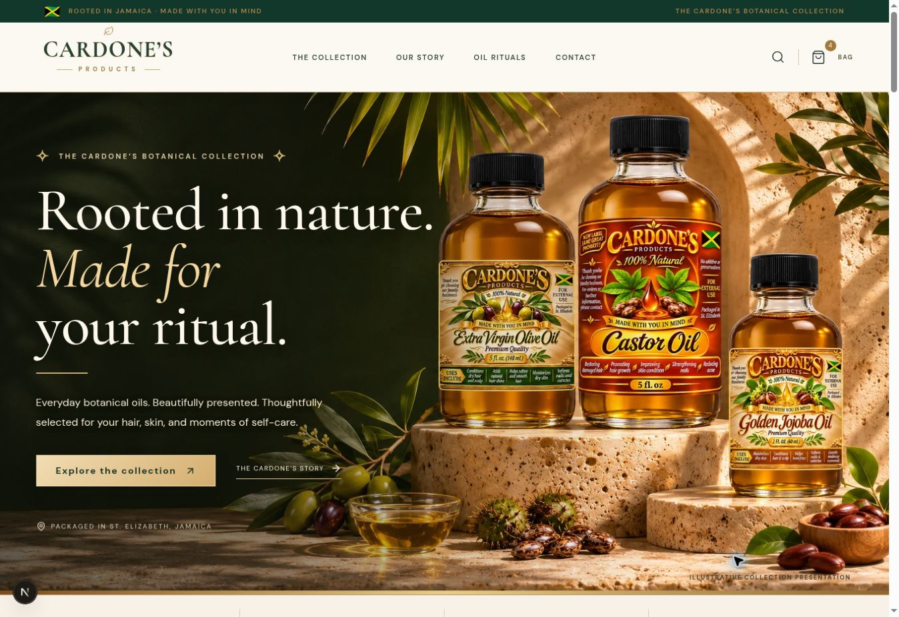
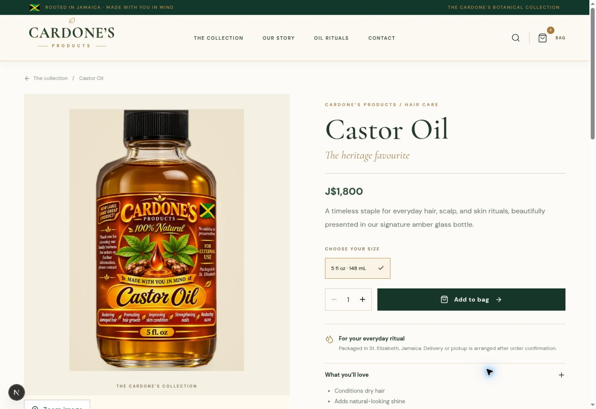
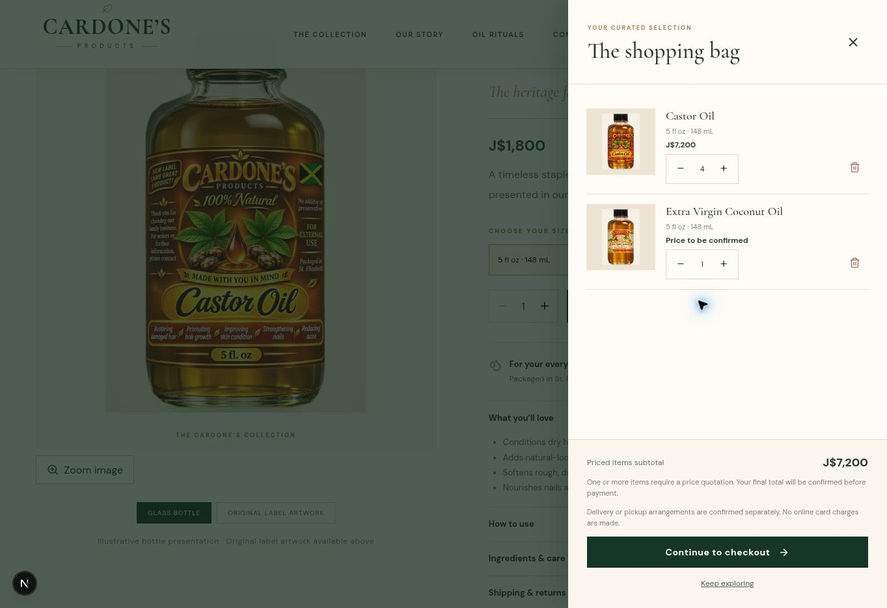
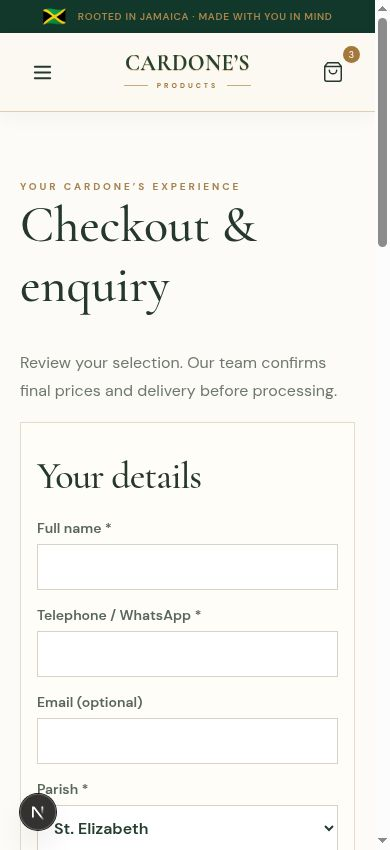
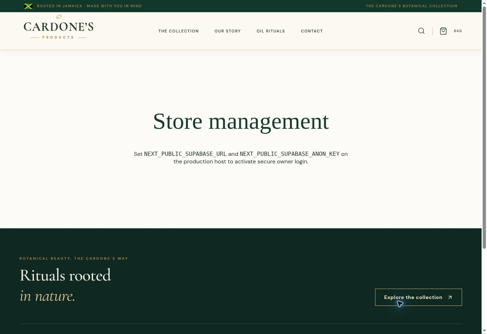

# Cardone’s verification — 20 November 2026

## Implemented

- New collection campaign, original Jamaican-inspired lifestyle image and oil-detail editorial study, optimized as WebP. Original labels and six intact bottle renders preserved; defective old cutouts are no longer used in the catalogue.
- Consolidated the active store dashboard, checkout and catalogue onto one normalized Supabase schema. Archived the incompatible unused migration and removed disconnected duplicate endpoints/components.
- Atomic settings/product/order-status saves with audit logs, password reauthentication for banking changes, strict Jamaican phone validation, safe HTTPS social links, editable delivery parishes, known delivery fees and order-status filters.
- Atomic request throttling, no automatic payment verification, private receipt review, fail-closed health reporting and paused defaults.
- Storefront data refresh on owner save, window focus and every minute. Empty/hidden catalogues no longer resurrect products. Related recommendations use the live catalogue.
- Clear quotation handling, recorded-order item summaries, touch targets, narrow form layouts, keyboard focus trapping, skip link and reduced-motion support.
- Reproducible lockfile, automated PostgreSQL tests, and an isolated static export script that preserves production source.

## Checks performed

| Check | Result |
|---|---|
| `npm test` | 3 tests passed, including embedded PostgreSQL migration execution |
| `npm run typecheck` | Passed |
| `npm run build` | Passed |
| `npm run build:preview` | Passed; routes/assets exported under the correct base path |
| Atomic catalogue import | Seven products imported; repeated import rejected |
| Conflicting variant ownership | Save rejected; preceding product change rolled back |
| Banking audit | Changes persisted; account value absent from audit data |
| Anonymous database access | Table read and settings RPC rejected |
| Rate limiter | First six hourly attempts accepted; seventh rejected |
| Shopping bag | Quantity updates, JMD totals and refresh persistence verified in browser |
| Unpriced coconut + priced castor | Only priced subtotal displayed; quote requirement clearly shown |
| Avocado coming soon | No Add to Bag button; unavailable message shown |
| Catalogue search | Keyboard search for jojoba displayed one matching oil |
| `/api/admin` without owner token | Returned “Owner access required” |
| `/api/health` without backend configuration | `databaseReachable:false`, `ordersEnabled:false`, `paymentProcessing:false` |

Responsive measurements covered **320, 360, 375, 390, 430, 768, 1024 and 1440px** for the homepage, shop, castor product, populated checkout and unconfigured admin screen. No document horizontal overflow remained. A 320px form overflow was found and fixed. Tests used same-origin browser frames; the browser's 15px vertical scrollbar reduces the measured document client width. Raw measurements: [responsive-checks.json](responsive-checks.json).

## Not verified or activated

No production Supabase URL/keys or owner account were supplied. No live database was modified. Owner sign-in, authenticated dashboard persistence against Supabase, live receipt uploads/signed URLs, real order persistence, banking changes through the deployed API, WhatsApp handoff and email notification delivery still require configured-host end-to-end testing. The admin screenshot therefore shows its actual configuration-required state, not a fabricated authenticated dashboard.

The application remains a request/quotation store, with no card charging or automated settlement. Stock checks are not atomic reservations. Merchant confirmation is required for fulfilment. See [README](../README.md) for deployment steps and operational limits.

## Actual browser screenshots

Homepage:

Product:

Shopping bag:

Mobile checkout (390px):

Owner area — configuration required:

